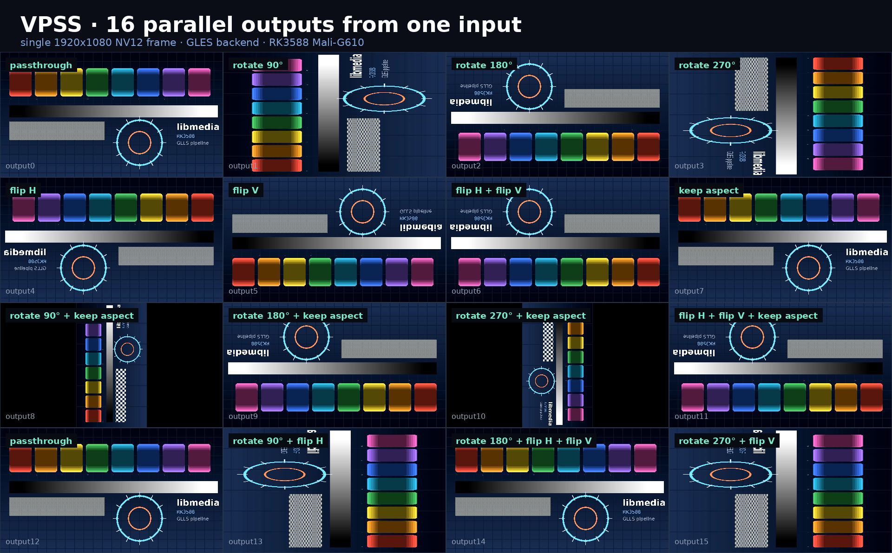

# libmedia release

**English** | [简体中文](README.zh-CN.md)

Binary release mirror for `libmedia`.



One 1920×1080 NV12 frame in, 16 independently configured outputs out — rotation, mirroring and aspect-preserving letterbox per port, all on the GLES backend of a RK3588 (Mali-G610). Captured from a real board.

## Contents

- `lib/libmedia.so`: core library with the embedded Ed25519 public key.
- `plugins/*.so`: external modules.
- `plugins/*.so.sig`: detached signatures matched to each plugin byte-for-byte.
- `include/`: public application and plugin headers.
- `docs/`: [module index](docs/README.md) — per-module type names, ports, configuration and limits.
- `examples/minimal/`: load one signed plugin.
- `examples/load_all/`: scan and load all signed plugins in the release directory.
- `examples/vpss_16out/`: one input, 16 independently configured VPSS outputs (the demo above).

### Modules

The release ships 37 external modules. Start from the [module index](docs/README.md), which links to a page per module (type name, kind, ports, configuration fields, usage and known limits).

Sources: `vi` `tpg` `vdec` `audio` · Processing: `vpss` `vmix` `vmix_rga` `osd` `rga` `csc_rga` `resize_rga` `transform` `dualview` `stereo_3d` `svm_3d` `panorama` · Fusion: `mcf_fusion` `thermal` `thermal_lowlight_fusion` `fluo_visible_fusion` `exposure_fusion` `blend_pyr` `edof` · Enhancement: `eis` `tnr` `wavelet_nr` `clahe` `retinex` `highlight_suppress` `cap_dehaze` `dcp_fast_dehaze` `demosaic` `conv` `raw_wb` · Output: `vo` `vo_wbc` `venc`

No private key or PEM file is included in this release repository. The core library already contains the verification public key.

## License

Free for personal, research and non-profit use. Commercial use — including products, project delivery and internal production systems — requires a written license. See [LICENSE.md](LICENSE.md).

## Signature verification

Every plugin is loaded through `MEDIA_PLUGIN_LoadSelf()`, which verifies the plugin image against its adjacent `.sig` file before mapping it. A plugin is rejected when:

- the `.sig` file is missing;
- the plugin has been modified in any byte;
- the signature was produced with a different key.

The `.sig` files are produced with the release key and must be shipped alongside the plugins. Do not modify or remove them.

## Build the minimal example

```sh
cmake -S examples/minimal -B build/minimal
cmake --build build/minimal
(cd build/minimal && ./libmedia_minimal)
```

The plugin `.so` and its adjacent `.so.sig` must both be present. If either is missing, or if the plugin has been changed, `MEDIA_PLUGIN_Load()` rejects it.

## Build the load-all example

```sh
cmake -S examples/load_all -B build/load_all
cmake --build build/load_all
(cd build/load_all && ./libmedia_load_all)
```

This example loads every plugin found in `../../plugins` and prints the number of plugins accepted. Note that a single process holds at most `MEDIA_PLUGIN_MAX_LOADED` (32) plugins at a time; plugins beyond that limit are reported as `too many plugins loaded`. An application should load only the modules it needs.

The signing key is maintained separately. New releases must be signed before publication.

## Build the 16-output example

This is the pipeline behind the image above.

```sh
cmake -S examples/vpss_16out -B build/vpss_16out
cmake --build build/vpss_16out
mkdir -p frames
LD_LIBRARY_PATH=plugins:lib ./build/vpss_16out/vpss_16out frames 1 0
```

It writes `frames/frame_000.rgb` (raw RGB24, 1920×1080) plus `frames/info.txt` with the canvas size. The default source is the built-in test pattern; pass `img:<file>` to feed your own raw RGB24 1920×1080 frame instead.

Every output port runs an independent transform — rotation, mirroring and aspect-preserving letterbox — on one shared input frame. Frames are pulled with `MEDIA_SYS_GetFrame`, so the example never touches DRM and runs even while a desktop owns the display.
