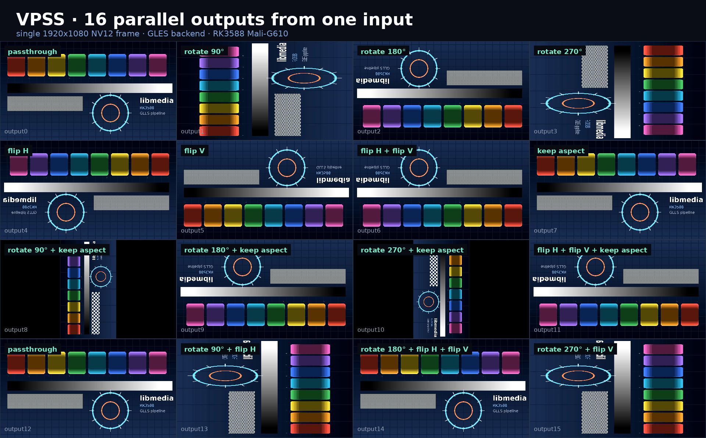

# libmedia 发布包

[English](README.md) | **简体中文**

`libmedia` 的二进制发布仓库。



一路 1920×1080 NV12 输入，16 路各自独立配置的输出 —— 每路单独做旋转、镜像、保宽高比留边，全部跑在 RK3588（Mali-G610）的 GLES 后端上。图是真机采集的。

## 内容说明

- `lib/libmedia.so`：核心库，已内嵌 Ed25519 公钥。
- `plugins/*.so`：外部模块。
- `plugins/*.so.sig`：与每个插件逐字节对应的分离签名。
- `include/`：应用侧与插件侧公开头文件。
- `docs/`：[模块索引](docs/README.zh-CN.md) —— 每个模块的 type 名、端口、配置字段与限制。
- `examples/minimal/`：加载单个已签名插件的示例。
- `examples/load_all/`：扫描并加载发布目录内全部已签名插件的示例。
- `examples/vpss_16out/`：一路输入、16 路独立配置输出（即上面那张图）。

### 模块一览

发布包内含 37 个外部模块。请从[模块索引](docs/README.zh-CN.md)开始，那里链接到每个模块的单独页面（type 名、类型、端口、配置字段、使用示例与已知限制）。

数据源：`vi` `tpg` `vdec` `audio` · 处理：`vpss` `vmix` `vmix_rga` `osd` `rga` `csc_rga` `resize_rga` `transform` `dualview` `stereo_3d` `svm_3d` `panorama` · 融合：`mcf_fusion` `thermal` `thermal_lowlight_fusion` `fluo_visible_fusion` `exposure_fusion` `blend_pyr` `edof` · 增强：`eis` `tnr` `wavelet_nr` `clahe` `retinex` `highlight_suppress` `cap_dehaze` `dcp_fast_dehaze` `demosaic` `conv` `raw_wb` · 输出：`vo` `vo_wbc` `venc`

本仓库不包含任何私钥或 PEM 文件。核心库中已经包含用于验签的公钥。

## 授权

个人学习、科研与非营利使用免费。商业使用 —— 包括产品、项目交付与内部生产系统 —— 需要取得书面授权。见 [LICENSE.md](LICENSE.md)。

## 签名校验

每个插件都通过 `MEDIA_PLUGIN_LoadSelf()` 加载，该函数在映射插件映像之前，会先用同目录下的 `.sig` 文件验签。出现以下情况时插件会被拒绝加载：

- `.sig` 文件不存在；
- 插件的任何一个字节被修改；
- 签名由其他密钥生成。

`.sig` 文件由发布密钥生成，必须与插件一同分发，请勿修改或删除。

## 编译 minimal 示例

```sh
cmake -S examples/minimal -B build/minimal
cmake --build build/minimal
(cd build/minimal && ./libmedia_minimal)
```

插件的 `.so` 与其同目录下的 `.so.sig` 必须同时存在。缺少任意一个，或插件内容被改动，`MEDIA_PLUGIN_Load()` 都会拒绝加载。

## 编译 load_all 示例

```sh
cmake -S examples/load_all -B build/load_all
cmake --build build/load_all
(cd build/load_all && ./libmedia_load_all)
```

该示例会加载 `../../plugins` 下的全部插件并打印成功加载的数量。注意：单个进程同时最多持有 `MEDIA_PLUGIN_MAX_LOADED`（32）个插件，超出部分会报 `too many plugins loaded`。实际应用中应只加载自己需要的模块。

签名密钥单独维护。新版本发布前必须先完成签名。

## 编译 16 路输出示例

上面那张图就是这条管线跑出来的。

```sh
cmake -S examples/vpss_16out -B build/vpss_16out
cmake --build build/vpss_16out
mkdir -p frames
LD_LIBRARY_PATH=plugins:lib ./build/vpss_16out/vpss_16out frames 1 0
```

输出 `frames/frame_000.rgb`（原始 RGB24，1920×1080）和 `frames/info.txt`（画布尺寸）。默认源是内置测试图案；传 `img:<文件>` 可以喂自己的 1920×1080 原始 RGB24 帧。

16 个输出端口共用一路输入帧，各自独立做旋转、镜像和保宽高比留边。取帧走 `MEDIA_SYS_GetFrame`，全程不碰 DRM，桌面上也能跑。
